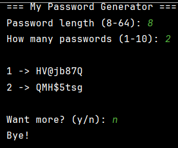

# My Password Generator

A simple password generator that runs in the terminal. You tell it how long the password should be and how many you want, and it prints random passwords with letters, numbers and symbols.

I made this for Task 1 of the Python Developer Internship at Auspify Technologies.

## What it does

- Asks for the password length (8 to 64 characters)
- Asks how many passwords to generate (1 to 10)
- Every password has at least one letter, one number and one symbol
- Keeps asking again if the input is empty, has letters, is negative or is out of range
- Lets you generate more passwords without restarting the program

## Built with

- Python 3.13
- `secrets` and `string` (both come with Python)
- PyCharm

## How to run

1. Install Python 3
2. Download this project
3. Open a terminal in the project folder and run:

```
python main.py
```

## How it works

1. The program asks for the length and the number of passwords.
2. If the input is not a proper number in the allowed range, it asks again.
3. For each password, it first picks one letter, one number and one symbol, so the password always has all three.
4. The remaining characters are picked randomly from letters, numbers and symbols together.
5. The characters are shuffled, so the first three are not always in the same order.
6. The passwords are printed and the program asks if you want more.

I used the `secrets` module instead of `random`. `random` is fine for games, but it is not meant for security. `secrets` uses a more secure random source, which is better for passwords.

## Screenshots

Normal run:



## Limitations

- Works only in the terminal, there is no GUI
- The list of symbols is fixed
- It does not tell you how strong a password is
- Passwords are only shown on the screen, not saved anywhere

## What I want to add next

- Password strength feedback
- Let the user choose whether to include symbols or numbers
- Copy the password to the clipboard

## What I learned

- How `input()` works and why the value has to be converted to a number before using it
- How to use `while` loops to keep asking until the input is correct
- How to split a program into small functions
- The difference between `random` and `secrets`, and why `secrets` is better for passwords
- How to check user input so the program does not break on wrong values

## Note

I built this while learning Python, with guidance from an AI assistant (Claude), and I ran and checked the program myself in PyCharm.